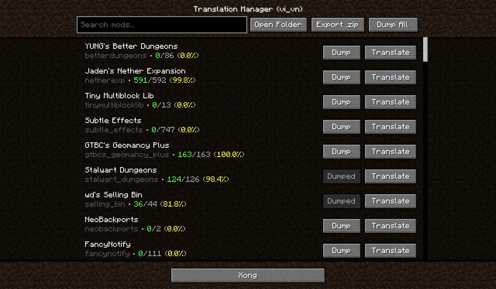
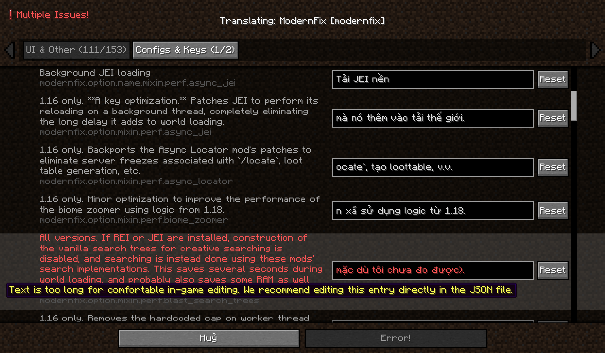
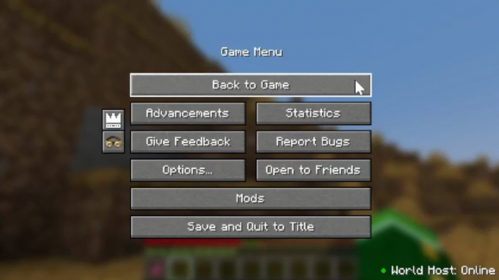
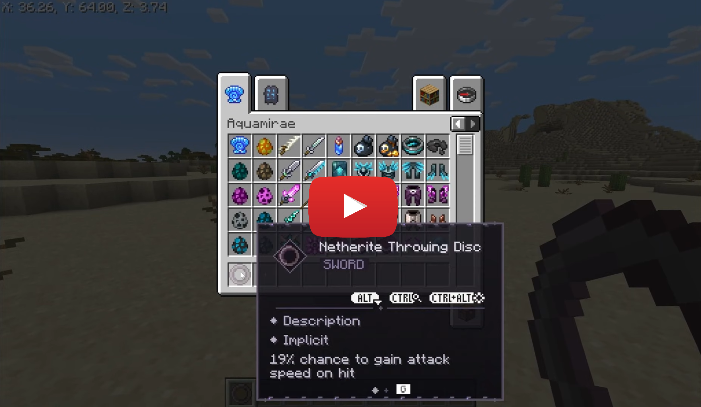

# PolyJot: In-Game Text & Item Name Editor

> **Using an in-game editor to change/translate modded Items, Advancements, and Tooltips on the fly!**

Ever looked at an item from a mod and thought, _"why on earth is this named that?"_

Or maybe you found an amazing mod that has zero translations for your language, but _dread_ the thought of unzipping `.jar` files, wrestling with raw JSON brackets in Notepad, and waiting through twenty agonizing `F3 + T` reload screens only to realize you made a typo?

PolyJot fixes that! It digs up the language files from all the mods and resource packs you have installed and puts them straight into a clean, searchable in-game editor. Type your new name, click **Save & Quit**, and _boom_, it's updated in your hotbar right away. _100% Client-side_, by the way.

_(This mod was made to edit **other mods**! If you want to change Vanilla texts, you'd unfortunately have to make your own Resource Pack.)_

---

---

## So… what's in it for you? (The fun stuff :D)

- You can rename **anything into whatever you want.** Hate that an endgame weapon has a 5-paragraph edgy name? Change it to "Spatula Sword" in five seconds, done.

- Translating a whole mod into Spanish, French, Chinese, heck, even Pirate Speak? Open PolyJot, type your translations, and play.

- **You don't have to reload!** Normally in Minecraft, reloading language and resource packs locks up your game for 30 seconds while your PC fans scream as it tries to load all 28 of your Resource Packs all over. PolyJot injects text straight into memory the second you hit Save.

- But hey, nobody wants to scroll past 800 config keys just to find the name of an apple. Worry not, entries are automatically split into **Gameplay** (items, blocks, entities, effects), **UI & Other**, and **Configs & Keys**.

- Finished translating a mod? Hit **Export .zip**, give your pack a name, and PolyJot spits out a clean resource pack directly into your `.minecraft/resourcepacks/` folder, ready to send to your friends or pack into a modpack!

- Best part is, if you edited something in, say, Spanish, and you switched your Minecraft language to English, it will **not** carry over! Each language can have its own translation! (Though, it's the bare minimum of a mod created to aid translating…)

- Are you using an AI translation mod? _Come on, I know some of you are_. No problem, let the Machines do the heavy lifting, jump into your world, and the second you spot a broken translation, open PolyJot and fix it on the spot in five seconds!

- Oop, PolyJot won't dump hundreds of empty JSON files onto your hard drive. It only creates a file when you actually edit or dump a mod, keeping your folders lightweight.

- Got a whole team of translators? Grab their in-progress pack, drop it in, and hit **Dump All** in the menu to pull their translations into your local editable files and track the current progress instantly!
    

## How to use? (Takes like 10 seconds, trust me)

1.  **(If you're trying to translate a mod to your language):** Change your Minecraft language to the target language.
2.  **Open the menu:**
    - Type `/polyjot` or `/lang` in chat, or go to `Mods` -> find **PolyJot** -> click **Config**.
    - _(Optional)_ You can also set a dedicated keybind in your Minecraft controls.
3.  **Pick a mod!** Use the search bar to find any mod by name or Mod ID, then click **Translate**.
4.  **Now you're in the editor.** Type whatever you want in the box on the right.
5.  **Hit Save & Quit,** then peek at your inventory/Achievement page/whatever you changed. The new name is already there!

**Note:** If you're a Server Owner or Modpack creator, you should click **Export .zip** and get the pack from your `.minecraft/resourcepacks/` folder. You can now send it to others or upload it to your Server/Modpack.

## Some extra info for Modders & Pack makers

<b>Looking under the hood...</b>

PolyJot uses Forge's `IModFile.findResource()` directly on disk to scan `assets/<modId>/lang/en_us.json` straight from the mod JAR. It also discovers sub-namespaces within multi-module mod JARs, then uses `JsonParser.parseReader()` streaming to tolerate duplicate keys, trailing commas, and formatting quirks without throwing `JsonSyntaxException`. PolyJot bypasses the heavy reload cycle _(at least tries to)_ by:

- Injecting updated key-value mappings straight into Minecraft's active `Language` / `ClientLanguage` instance via reflection.
- Automatically falls back to a dynamic `Language` delegation wrapper if reflection is blocked by security managers. Saved translations live in `.minecraft/translations/<language>/<modId>.json`. It also dynamically registers a built-in virtual resource pack (`polyjot_live_translations`) pinned at `Pack.Position.TOP`. Your edits persist across restarts without needing to export a manual `.zip`.

O(1) Scroll Caching? 🤔 Cloth Config screens with 1,000+ entries (like _Apotheosis_ or _Alex's Caves_) can lag due to repetitive font measurement and glyph splitting. PolyJot caches line heights and split text (O(1) lookup during scrolling), maintaining smooth navigation even on monstrous language files. Though, it's not foolproof…

## Requirements

- **Minecraft:** Forge/Fabric `1.20.1` (For now)
- **Required Dependency:**  (`11.1.136+`)

## Known Issues

- Sometimes the search bar for Mods can act up and not give results. (Will fix soon enough)
- Accessing heavy JSON files can cause pretty big performance issues. (The biggest limitations are my knowledge, I still haven't found a way to fix this yet)
- If your edited text doesn't display after restarting the game, try pressing `Export .zip` and enabling the Resource Pack.

## License

This project is licensed under the MIT License. Feel free to use it in any modpack! (Just credit me vro…)